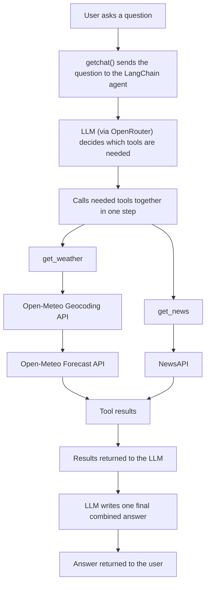

# LangChain Weather & News Agent


A conversational agent built with LangChain's `create_agent` that answers combined weather and news questions in a single turn. It routes requests through **OpenRouter** to an LLM, which decides which tools it needs and calls them together, then merges the tool results into one final answer. Execution is traced with **LangSmith**.

## Features

- Natural-language queries that mix weather and news in one question (e.g. "weather in Lahore and the latest Tesla news")
- Parallel tool calling — the LLM calls `get_weather` and `get_news` together in a single step instead of one at a time
- Weather lookup via the free [Open-Meteo](https://open-meteo.com/) geocoding + forecast APIs (current conditions + 3-day forecast)
- News lookup via [NewsAPI](https://newsapi.org/)
- LLM access through [OpenRouter](https://openrouter.ai/), so any OpenRouter-hosted model can be swapped in
- Full run tracing with [LangSmith](https://smith.langchain.com/)

## Architecture



## Project Structure

| File | Description |
|---|---|
| `main.py` | Agent definition, tools (`get_weather`, `get_news`), and `getchat()` entry point |
| `.env.example` | Template listing required environment variables (no real values) |
| `requirements.txt` | Dependencies for users not using `uv` |
| `pyproject.toml` | Project metadata and dependencies (used by `uv`) |
| `uv.lock` | Locked dependency versions for `uv` |

## Getting Started

```bash
# 1. Clone the repository
git clone https://github.com/<your-username>/langchain-weather-news-agent.git
cd langchain-weather-news-agent

# 2. Create a virtual environment
python -m venv .venv
source .venv/bin/activate   # Windows: .venv\Scripts\activate

# 3. Install dependencies
pip install -r requirements.txt
# or, if you use uv:
uv sync

# 4. Copy the example env file and add your keys
cp .env.example .env

# 5. Run the agent
python main.py
```

## Environment Variables

| Variable | Description | Where to get it |
|---|---|---|
| `OPENROUTER_API_KEY` | API key used to call the LLM through OpenRouter | [openrouter.ai/keys](https://openrouter.ai/keys) |
| `OPENAI_API_KEY` | Used internally by the OpenAI-compatible client; set to the same OpenRouter key | [openrouter.ai/keys](https://openrouter.ai/keys) |
| `NEWS_API_KEY` | API key for fetching news articles | [newsapi.org](https://newsapi.org/) |
| `LANGSMITH_TRACING` | Set to `true` to enable LangSmith tracing | — |
| `LANGSMITH_ENDPOINT` | LangSmith API endpoint | [smith.langchain.com](https://smith.langchain.com/) |
| `LANGSMITH_API_KEY` | API key for LangSmith tracing | [smith.langchain.com](https://smith.langchain.com/) |
| `LANGSMITH_AGENT_ID` | Identifier shown for this agent's traces | set by you |
| `LANGSMITH_AGENT_ENVIRONMENT` | Environment label for traces (e.g. `local`) | set by you |

> **Note:** OpenRouter requires account credits to make model calls. Add credits at [openrouter.ai](https://openrouter.ai/) before running the agent.

## Example Questions

- "What's the weather in Lahore and give me one news article about it?"
- "Compare the weather in Tokyo and London, and show me the latest AI news."
- "Give me the current weather in New York."
- "What's the latest news about Tesla?"

## Security

API keys are never hard-coded. All secrets are loaded from a local `.env` file via `python-dotenv` and read through `os.getenv()`. The `.env` file is excluded from version control via `.gitignore` — only `.env.example` (with empty placeholders) is committed.
